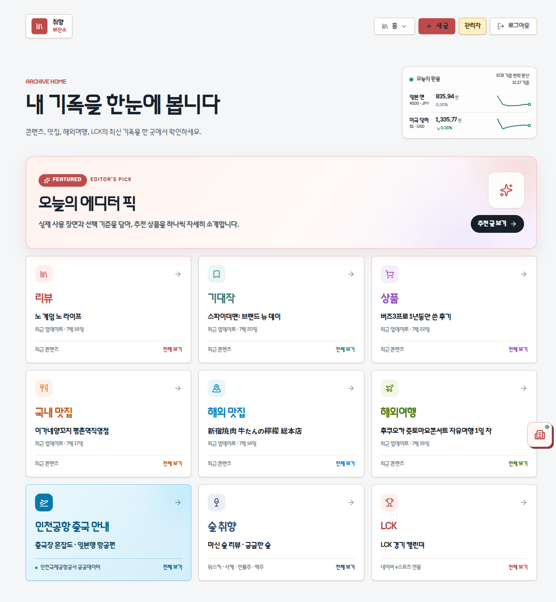

# 취향 보관소

좋아하는 콘텐츠, 맛집, 여행과 술을 기록하고 나누는 취향 아카이브입니다.
개인적인 감상부터 여행에 필요한 정보까지 한곳에서 모아볼 수 있도록 만들었습니다.

[사이트 열기](https://syun-archive.vercel.app)

<p align="center">
  
</p>

## 콘텐츠 구성

| 콘텐츠 | 소개 |
| --- | --- |
| 리뷰·기대작 | 영화, 애니, 게임, 드라마의 감상과 앞으로 보고 싶은 작품을 기록합니다. |
| 상품 리뷰 | 직접 사용한 상품의 후기와 별점을 남기고 네이버 상품 검색을 연결합니다. |
| 국내·해외 맛집 | 방문 후기와 사진을 남기고 목록과 지도에서 찾아봅니다. |
| 해외여행 | 방문한 장소를 날짜·시간별로 정리하고 지도와 동선으로 확인합니다. |
| 술 취향 | 위스키·사케·전통주·맥주 등의 시음 후기와 궁금한 술을 모읍니다. 반 별 평점, 사진, 마신 방법과 맛 태그를 지원합니다. |
| 인천공항 출국 안내 | T1·T2 출국장 혼잡도와 인천발 일본행 항공편을 한국 시간 기준으로 보여줍니다. |
| 추천 콘텐츠 | 토스쇼핑 인기 상품의 가격·평점·순위를 확인하고 상품 페이지로 이동합니다. |
| 일정·환율 | 작품 공개 일정, LCK 경기·밴픽 자료와 원화 기준 환율을 확인합니다. |

이메일 인증으로 가입하고, 닉네임으로 글과 사진을 등록할 수 있습니다.
내 계정에서 닉네임·비밀번호 변경과 탈퇴를 지원하며, 관리자는 콘텐츠·외부 API 운영 현황을 확인합니다.

## 기술 스택

| 구분 | 사용 기술과 역할 |
| --- | --- |
| 웹 앱 | **Next.js 16 · React 19 · TypeScript** — App Router, 서버 렌더링과 사용자 인터랙션. |
| UI | **Tailwind CSS 4 · CSS Modules · Lucide** — 반응형 레이아웃, 화면별 스타일과 아이콘. |
| 데이터·인증 | **Supabase Auth · PostgreSQL · Storage** — 로그인, 게시글, 사진 저장과 RLS 권한 관리. |
| 외부 연동 | **Google Maps · 공공데이터포털 · 네이버 · 토스 쉐어링크** — 지도, 공항 정보, 상품 검색과 추천. |
| 배포·운영 | **Vercel · GitHub Actions** — 자동 배포와 빌드 검사. Analytics·Speed Insights로 사용 현황과 성능을 확인합니다. |

공항·상품 API의 인증키는 서버에서 사용하며, 사진은 Supabase Storage에 저장합니다.
모바일에서는 하단 메뉴로 주요 콘텐츠와 출국 안내에 바로 접근할 수 있습니다.

## 로컬 실행

Node.js 24.22.1 이상, 25 미만을 사용합니다.

```bash
npm install
cp .env.example .env.local
npm run dev
```

환경변수를 입력한 뒤 [localhost:4281](http://localhost:4281)에서 확인합니다.
DB와 외부 서비스 설정은 [설정 가이드](docs/SETUP.md)를 참고하세요.

## 확인

```bash
npx tsc --noEmit
npm run lint
npm run build
```

main 브랜치에 푸시하면 Vercel에서 자동 배포됩니다.
